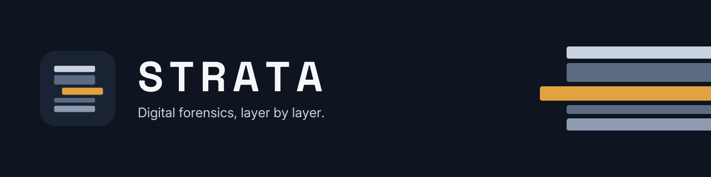
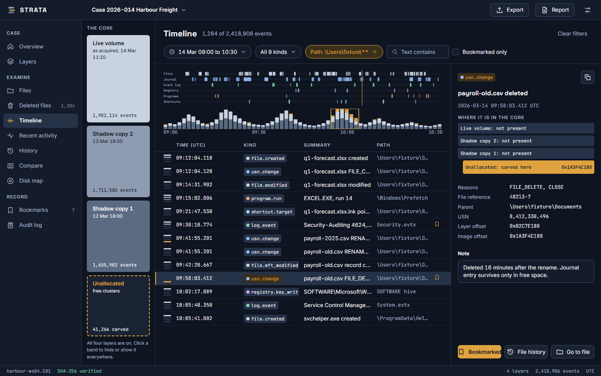
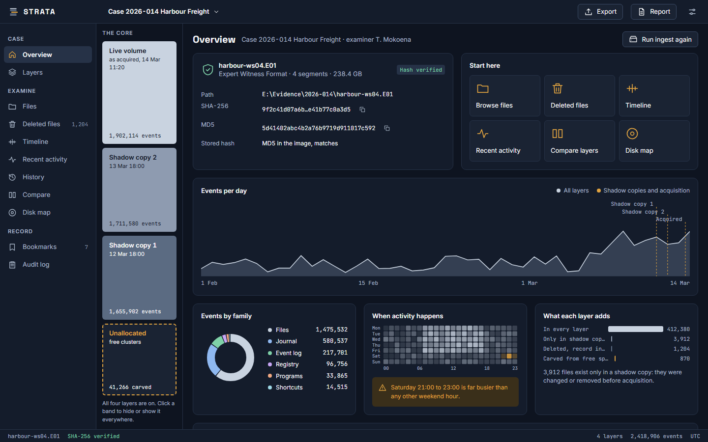
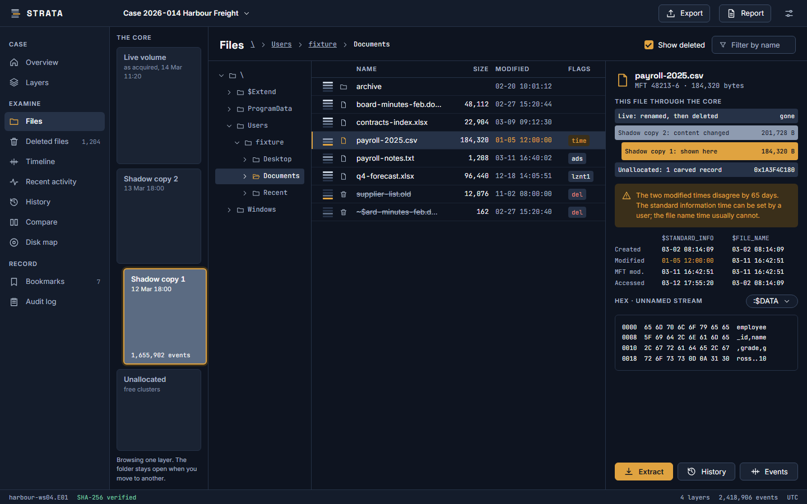
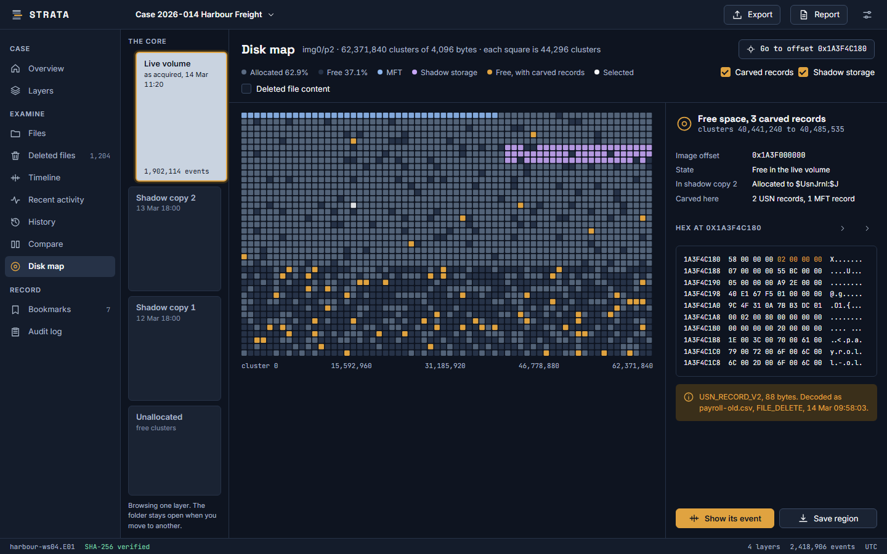
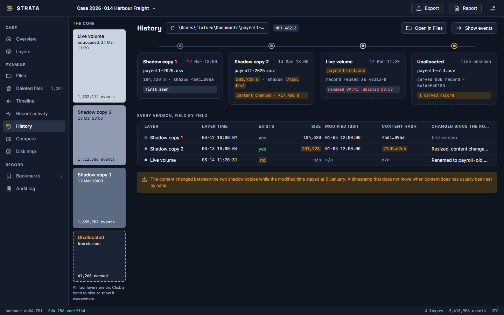

<p align="center">
  
</p>

<p align="center">
  
  
  
  
  
</p>

<p align="center">
  <a href="#what-is-strata">What it is</a> ·
  <a href="#where-does-the-project-stand">Status</a> ·
  <a href="#what-will-it-look-like">Design</a> ·
  <a href="#how-is-it-built">Architecture</a> ·
  <a href="#what-is-the-plan">Plan</a> ·
  <a href="CONTRIBUTING.md">Contributing</a>
</p>

## What is Strata?

Strata is a digital forensics suite for Windows evidence. It opens a disk image and reads every layer of it: the live file system, each volume shadow copy, and unallocated space. It then puts what it finds on one timeline.

Every event keeps its provenance: the layers it was read through and its byte offset in the image. An examiner can check any finding by hand with a hex viewer.

The part that sets it apart is comparison across layers. Strata follows the same file through the live volume, every shadow copy and the remnants carved from free space, and shows what changed and between which two moments.

## Where does the project stand?

**Strata is pre-alpha. No part of it runs yet.** This repository holds the complete plan, the interface specification, the approved design and the brand. The code is built from that plan, section by section.

Done:

- Scope, technology and architecture: the [foundation plan](docs/plans/2026-11-16-strata-foundation.md).
- Every command and screen: the [interface specification](design/SPEC.md).
- The full interface design, 18 screens: the [mockups](design/ui) and the [design contract](design/CONTRACT.md).
- The build plan, 111 sections in 10 phases: the [implementation plan](todo/implementation-plan.md).
- The brand: mark, wordmark, palette and banners in [`assets/brand`](assets/brand).

Not started: the Rust engine, the `strata` command line, the desktop app, installers and releases.

Do not use Strata on a real case until a release says it is ready.

## What will version 1 do?

- **Open evidence read-only.** Raw, split raw, fixed VHD and E01 images, with MD5 and SHA-256 checked against the hash the image stores.
- **Read the layers.** MBR and GPT partitions, NTFS with deleted records and alternate data streams, and every volume shadow copy as a volume in its own right.
- **Carve free space.** MFT records, change journal entries and event log chunks, recovered as structured records.
- **Build one timeline.** MFT timestamps, the USN journal, event logs, registry key writes, prefetch and shortcuts, with duplicates across layers merged.
- **Compare across layers.** File history through every layer, and a diff of any two.
- **Show it.** A workflow home with charts, a disk map with a hex view, deleted files with recoverability, recent activity by day.
- **Leave a record.** Bookmarks with notes, CSV and JSONL export, a self-contained HTML report, and an audit log with a hash chain.

Not in version 1: live acquisition, memory analysis, BitLocker, VHDX and VMDK, and file systems other than NTFS. The [foundation plan](docs/plans/2026-11-16-strata-foundation.md) lists every limit.

## What will it look like?

These are the approved design mockups, not screenshots of a running app. The desktop app is built to match them 1:1, and a pixel comparison in the test suite holds it to that ([design contract](design/CONTRACT.md)).

<p align="center">
  
</p>

<p align="center">
  
  
</p>
<p align="center">
  
  
</p>

The column of bands on the left of each screen is the core: one band per layer of the evidence, newest on top. It stays on screen and chooses which layers a view reads. Open any file in [`design/ui`](design/ui) in a browser to see a mockup live.

## How is it built?

Everything readable is a layer: a read-only, random-access byte source with a parent. A read in one layer resolves to a read in the layer below, down to the image file.

```text
image (raw, split raw, fixed VHD, E01)
  volume (a partition from MBR or GPT)
    file system (NTFS on the live volume)
    snapshot (one per shadow copy: the volume as it was)
      file system (NTFS on the snapshot)
    unallocated (the clusters NTFS marks free)
```

| Part | Choice |
| ---- | ------ |
| Engine and command line | Rust, one Cargo workspace, no `unsafe`, parsers that never panic on hostile input |
| Shadow copies | Strata's own reader, so each block's origin is known |
| Case store | DuckDB, one file per case |
| Desktop app | Tauri 2 with React and TypeScript, calling the engine in-process |
| Dependencies | Permissive licences only, enforced by `cargo deny` |

The engine and the two interfaces are separate crates with one-way dependencies. The [foundation plan](docs/plans/2026-11-16-strata-foundation.md) has the whole picture.

## What is the plan?

| Phase | Ends with |
| ----- | --------- |
| 0 | A workspace that builds and a fixture image with known contents |
| 1 | `strata image info`, `image verify` and `layers` |
| 2 | `strata fs ls` and `fs stat`, including deleted files |
| 3 | Shadow copies listed and browsable as layers |
| 4 | Records carved from unallocated space |
| 5 | `strata case ingest` and `strata timeline` |
| 6 | History, comparison, export, extraction and the report |
| 7 | Every screen of the desktop app, matching the design |
| 8 | An installer, a user guide and an acceptance run |

The live state is in [`todo/implementation-plan.md`](todo/implementation-plan.md). Each section names its files, its steps and a test that can fail, and closes only after a review by a model from a different family than the one that wrote it.

## How do I work on it?

The plan is processed with the agent skills in this repository. Until phase 0 has shipped there is nothing to build or run. To check the plan itself:

```powershell
python scripts/todo-graph.py validate
python scripts/todo-graph.py query stats
python scripts/brand-assets.py     # rebuild the brand files
python scripts/design-shots.py     # re-render the design references
```

[CONTRIBUTING.md](CONTRIBUTING.md) explains how changes are proposed, and [AGENTS.md](AGENTS.md) holds the working rules.

## Security

Strata parses untrusted disk images, so parser safety is a design rule, not an afterthought. Report a vulnerability privately as [SECURITY.md](SECURITY.md) describes.

## License

Strata is licensed under the [Apache License, Version 2.0](LICENSE). The bundled typefaces (Space Grotesk, Inter and JetBrains Mono) are under the SIL Open Font License; their licence files are in [`assets/fonts`](assets/fonts).
